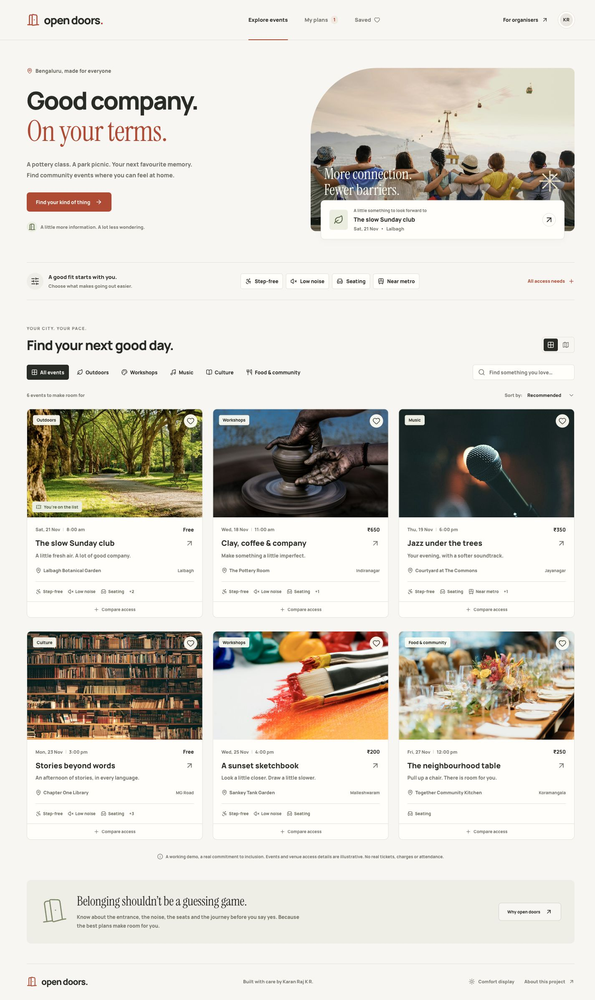
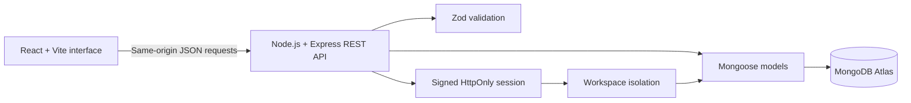

# Open Doors

### Good company. On your terms.

An inclusive community event directory that makes practical access information part of the invitation. Built by **Karan Raj K R** for **Semester 3 Backend Development CIA-II**.



**Assigned topic:** Community Event Access
**Theme:** Inclusive event information
**Differentiating feature:** Attendees filter events by their stated access needs.

## Try it

**Live preview: https://open-doors-karan.vercel.app**

MongoDB setup is intentionally deferred. The deployed site currently provides a clearly labelled read-only design preview: browsing, access matching, venue guides and comparisons work. Reservations and organiser writes stay disabled until `MONGODB_URI` is configured. The full persistence workflow has been verified locally with real MongoDB.

No account is required for the demo. Every visitor receives a separate, signed session and a personal MongoDB-backed workspace. You can explore both attendee and organiser tools without affecting another visitor.

## The two-minute demo

1. Open **All access needs**. Choose **Step-free access** and **Sign-language support**.
2. Turn on **Full matches only**. Open **Stories beyond words**.
3. Inspect the **Access guide**. Notice that unconfirmed information never counts as supported.
4. Choose **Save me a place**, use sample booking details, and reserve a demo place. Download the calendar invitation.
5. Open **My plans**. The reservation survives a reload.
6. Open **For organisers → Post an update**. Publish a change, then inspect that event’s **Updates** tab.
7. Edit an event’s access details, or publish your own event. Recheck the directory and matching results.

All events, prices, schedules and venue access claims are illustrative. There are no real tickets, payments, notifications or attendance commitments.

## Features

- Six access preferences: step-free entrance, lower noise, seating, public transport, accessible restroom and Indian Sign Language support.
- Explainable matching with explicit **available**, **not available** and **unconfirmed** states.
- Search, category filters, full-match filtering, price/date sorting and URL state.
- Event details, transport notes, noise information and an interactive arrival guide.
- Side-by-side event access comparison, highlighting your selected needs.
- Saved events, reservations, cancellation, booking references and valid `.ics` calendar export.
- Organiser event creation, editing, capacity controls and timestamped updates.
- Illustrated city location overview with external Maps directions.
- Responsive desktop/mobile layout, native dialog focus containment, keyboard controls, reduced motion and comfort display.
- Real MongoDB persistence through Mongoose; Express REST API with Zod validation and safe errors.
- Session-scoped access control, HttpOnly signed cookies, same-origin write checks, rate limiting and duplicate reservation protection.

## Run locally

Requires Node.js 22 and npm.

```sh
npm ci
cp .env.example .env
npm run dev
```

Open **http://localhost:5173**. The API runs on port 3001.

If `MONGODB_URI` is empty, local development downloads and starts an actual MongoDB process through `mongodb-memory-server`, with its data directory at `.data/mongo`. The first start needs internet access. For Atlas, set `MONGODB_URI` in `.env`. Set `SESSION_SECRET` to a stable random value so sessions survive server restarts.

```sh
npm test
npm run build
```

The integration tests launch a separate temporary MongoDB. They verify persistence, session isolation, validation, access matching, reservations, duplicate races, cancellation, organiser updates and cross-origin write protection.

## Architecture



| Layer | Implementation |
| --- | --- |
| Frontend | React, Vite, custom responsive CSS, Lucide icons |
| Backend | Node.js, Express, Zod, Helmet, express-rate-limit |
| Database | MongoDB through Mongoose, unique indexes |
| Identity | Signed session cookie; separate demo workspace per visitor |
| Hosting | Vercel frontend and Express serverless function |
| Tests | Node test runner, Supertest, temporary real MongoDB |

### REST endpoints

| Method | Route | Purpose |
| --- | --- | --- |
| GET | `/api/health` | Verify the database connection |
| GET | `/api/bootstrap` | Events, saved preferences and session bookings |
| GET | `/api/events` | Filtered directory and explainable match results |
| PUT | `/api/profile` | Persist preferences and saved events |
| POST | `/api/events` | Publish an event in the visitor’s workspace |
| PUT | `/api/events/:id` | Edit event details and access information |
| POST | `/api/events/:id/updates` | Publish an organiser update |
| POST | `/api/events/:id/bookings` | Reserve a demo place |
| DELETE | `/api/events/:id/bookings` | Cancel a demo reservation |

### Data model

- **Event:** workspace, title, category, venue, date, capacity/booked count, six nullable access flags, venue/transport/noise notes, embedded updates.
- **Profile:** workspace, selected access needs and saved event IDs.
- **Booking:** workspace, event ID, attendee details, optional note and reference. Unique workspace + event index prevents duplicate reservations.

Capacity is acquired with an atomic conditional increment. Duplicate booking failures roll back that increment. Requests are scoped to the signed session; clients cannot choose a workspace. This is an assessment demo with an isolated organiser role, not a production multi-organiser authentication system.

## Screenshot requirement mapping

| Assignment requirement | Implementation |
| --- | --- |
| Event directory | Responsive search and category-based event collection |
| Practical access information | Entrance, sound, seating, transit, restrooms and ISL details |
| Organiser updates | Persisted, timestamped updates visible in event details |
| Filter by stated access needs | Six-need profile, full-match filter and compatibility explanation |
| React UI | `src/App.jsx`, `src/components/` and `src/style.css` |
| Node.js + Express REST API | `server/app.js` and Vercel entry at `api/index.js` |
| MongoDB persistence | `server/models.js` |
| Input validation | Client constraints and server-side Zod schemas |
| Error handling | Inline forms, loading/empty/error states and consistent API errors |
| Responsive design | Recomposition for mobile, checked at 390px and desktop |

## Deployment

See [deployment instructions](docs/DEPLOYMENT.md). Never commit `.env`, database passwords or deployment tokens. Production requires `MONGODB_URI` and a strong `SESSION_SECRET`.

## Design & credits

Built using the supplied **design-studio** package: Refactoring UI, Craftwork, Emil design engineering and Web Interface Guidelines. See [design notes](docs/DESIGN.md) and [asset sources](docs/ASSETS.md). All photos and fonts are self-hosted. No AI service, paid API or email provider is required at runtime.
